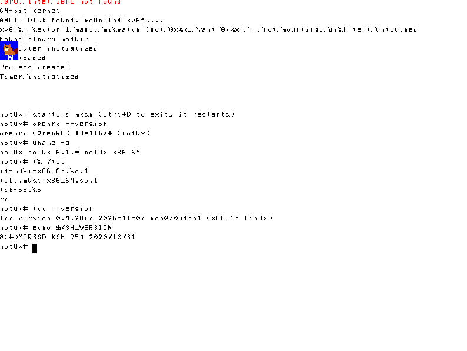

# notux kernel

  

**notux** — это минималистичная 64-битная операционная система, разрабатываемая с нуля для архитектуры x86_64 с упором на совместимость с Linux ABI.

Проект объединяет кастомное ядро, поддержку современных интерфейсов хранилищ и возможность нативного выполнения пользовательских программ (userland) на базе мул-окружения (musl libc).

> **Текущая версия:** `notux-0.0.16PREALPHA`

---

## Скриншоты

  
   
  <em>Запуск notux-0.0.16PREALPHA</em>

---

## Архитектура и особенности ядра

* **Режим работы:** 64-битный x86_64 (freestanding, без стандартной библиотеки C в ядре).
* **Файловые системы:** Реализована поддержка файловой системы **ext2**, а также адаптированная версия **xv6fs** (на основе кода MIT xv6). Дополнительно реализованы инструменты XVSX.
* **Оборудование и подсистемы:** Драйверы AHCI, поддержка локального APIC (lapic), подсистемы IGPU и системные вызовы с поддержкой трейсинга.
* **Совместимость с Linux ABI:** Полноценный запуск программ, скомпилированных с использованием musl libc (статические и динамические бинарники).

---

## Поддерживаемый софт (Userland)

Ядро способно нативно выполнять следующие компоненты и утилиты:

* **`mksh`** (MirBSD Korn Shell) — в качестве командной оболочки.
* **`fastfetch`** — вывод системной информации.
* **`sbase`** (suckless core utilities) — базовые утилиты UNIX.
* **`tcc`** (Tiny C Compiler) — компилятор C прямо в окружении ОС.
* Набор системных утилит и тестов на базе musl (`init`, `musl_ext2`, `musl_fs`, `musl_proc` и др.).

---

## Благодарности и использование ИИ

* **Разработчики xv6:** Часть кода файловой системы (`xv6fs`) и архитектурные концепции заимствованы из учебной операционной системы **MIT xv6**. Выражается благодарность разработчикам оригинального проекта за качественный исходный код.
* **Использование ИИ:** В процессе разработки и отладки проекта активно применялись инструменты искусственного интеллекта для помощи в написании кода, структурировании подсистем и решении низкоуровневых задач.

---

## Сборка и запуск

### Требования
* Компилятор `gcc` / `clang`, ассемблер `nasm`, инструмент `zig`
* Эмулятор `qemu-system-x86_64`
* Утилита `grub-mkrescue` (для сборки ISO-образа)

### Команды Makefile
* `make` — сборка ядра (`notux.bin`).
* `make iso` — создание загрузочного ISO-образа.
* `make run` — запуск системы в QEMU с CD-ROM.
* `make run-disk` — запуск с подключением AHCI-диска (`fs.img`).
* `make xvsx-tools` — сборка утилит для работы с XVSX файловой системой.

---

## Лицензия

Проект распространяется под лицензией **MIT License**.
